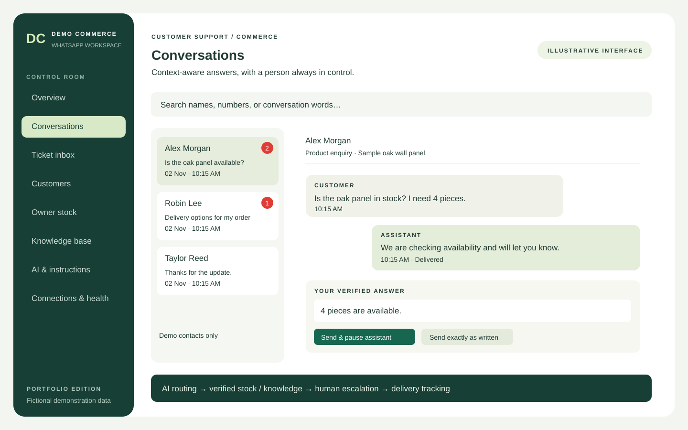
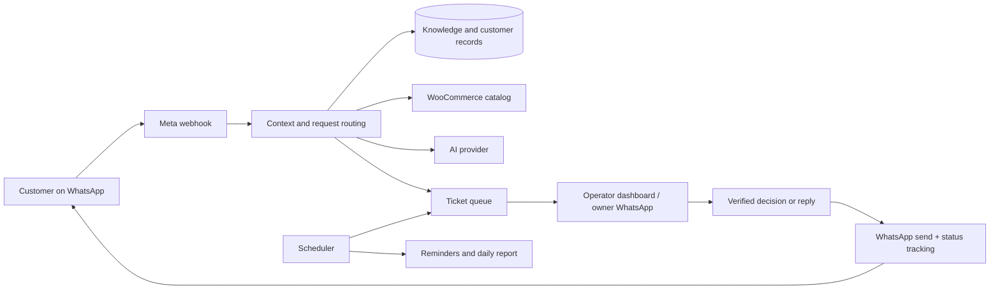

# WhatsApp AI Commerce Assistant

### AI support, human decisions, and a practical workspace for online stores.

A PHP and MySQL application that connects **WhatsApp Cloud API**, **WooCommerce**, and configurable AI providers. It helps a store answer product questions, hand uncertain requests to an operator, and keep conversations, stock decisions, and customer records in one place.

> **Portfolio edition:** adapted from a store-specific implementation. Business identity, contact details, infrastructure references, and fixture data have been anonymized. Credentials, live records, media, logs, and deployment history are not included. This is a reference implementation, not a hosted demo or a claim of audited production readiness.

*Illustrative interface overview with fictional data; not a screenshot of a customer's live workspace.*

## The business problem

Product enquiries arrive across text, images, and short follow-up messages. An assistant needs to keep context, distinguish confirmed stock from unknown availability, and involve a person without creating a new ticket for every follow-up.

This project combines AI conversation handling with explicit business rules and an operator dashboard. The important boundary is simple: **the model can phrase an answer; verified catalog data and operator decisions supply the facts.**

## Project scope

The implementation covers backend workflows, WhatsApp integration, WooCommerce catalog access, database design, the PHP/JavaScript dashboard, media handling, customer profiles, and regression fixtures. It also includes delivery-status processing and service-window-aware owner notifications.

No customer conversion, revenue, performance, uptime, or accuracy figures are claimed in this repository.

## Capabilities

| Area | What the implementation demonstrates |
|---|---|
| Customer conversations | Recent context, name/number/message search, unread counts, periodic live updates, and 12-hour display times |
| AI-assisted support | Configurable providers, editable store instructions, knowledge retrieval, and product-aware routing |
| Human takeover | Escalation tickets, stock decisions, polished replies, exact-text replies, and bot pause controls |
| Learning workflow | Operator-approved answers saved as reusable knowledge; exact replies can also be saved |
| Catalog and stock | WooCommerce product/variation lookup, cached catalog facts, and time-limited operator-confirmed stock |
| Ticket continuity | Related follow-ups can reuse an open request; unrelated product identifiers remain distinguishable |
| Media and reply context | Images/documents/video handling, multiple outgoing attachments, quoted replies, reactions, and deletion events |
| Delivery visibility | Accepted/sent/delivered/read/failed statuses where Meta supplies them |
| Owner operations | Recent-customer summaries, dated message digests, ticket reminders, and scheduled daily reports |
| Customer CRM | Contact profiles, explicit location extraction, product enquiries, consent state, and CSV export |
| Consent and campaigns | One-time permission requests and targeting restricted to opted-in contacts |
| Integration health | Connection summaries, provider usage estimates, and audit events |

**Media formats, phone-app message echoes, interactive buttons, and delivery receipts depend on the supported Meta events, account permissions, and server capabilities.** OCR requires an optional server installation. The dashboard uses polling, so it is near-real-time rather than a WebSocket system.

## A typical support flow

1. A customer asks about a product or sends a picture.
2. The application keeps reply context and looks for a relevant catalog or knowledge match.
3. Confirmed information can be used in a response; uncertain availability becomes an operator request.
4. The operator confirms stock, writes a verified answer, or takes over the conversation.
5. The answer is delivered, relevant knowledge can be retained, and the ticket is completed only after API acceptance. Later delivery failures are handled separately.

## Engineering decisions worth reviewing

- **Uncertain stock is not a model guess.** Operator-confirmed states have expiry rules and variation-level scope.
- **Incoming events are not all questions.** Reactions and deletion events have separate handling.
- **Conversation continuity has boundaries.** Product identifiers and short follow-ups help reconcile requests without blindly merging every question from the same person.
- **Manual wording can stay manual.** Exact-text replies bypass AI composition while retaining an optional learning path.
- **Consent is explicit state.** A missing response is not an opt-in; campaign delivery checks the recorded state.
- **Delivery acceptance is not a read receipt.** Webhook status updates track later results when available.
- **Owner notifications have their own service window.** Outside it, the code attempts a configured approved template; approval, billing eligibility, and platform limits still apply.

## Technology

**PHP 8.2+ · MySQL/MariaDB · vanilla JavaScript · HTML/CSS · WhatsApp Cloud API · WooCommerce REST API**

Provider adapters include OpenAI, Anthropic, Gemini, and compatible APIs. Availability depends on the configured provider, model, and credentials.

## Explore the source

| Entry point | Responsibility |
|---|---|
| [`webhook.php`](webhook.php) | Signature verification, incoming events, phone-app echoes, delivery statuses |
| [`owner.php`](owner.php) | Operator dashboard and conversation actions |
| [`lib/engine.php`](lib/engine.php) | Request handling and answer composition |
| [`lib/request_flow.php`](lib/request_flow.php) | Request continuity, deletion handling, and pending replies |
| [`lib/stock.php`](lib/stock.php) | Stock decisions, expiry, scheduling, and sync |
| [`lib/owner_notify.php`](lib/owner_notify.php) | Owner service-window tracking and operational send routing |
| [`lib/customers.php`](lib/customers.php) | Profiles, consent, exports, and campaign queues |
| [`lib/media.php`](lib/media.php) | Media validation, archive, OCR/hash helpers |
| [`tests/`](tests/) | Isolated regression fixtures |

## Run and evaluate

- [Setup guide](docs/SETUP.md): environment configuration and deployment boundaries.
- [Privacy and publication notes](docs/PRIVACY.md): what this edition excludes.
- [Test instructions](tests/README.md): syntax and isolated regression checks.

There are **no working API keys, a populated database, or a public customer dashboard** in this repository. A fresh deployment needs its own accounts and configuration. Anonymized fixtures can run separately from those services.

## External-service boundaries

WhatsApp templates must exist on the same WhatsApp Business Account as the sending number, with matching names and language codes. Business-initiated templates may require valid billing and incur charges. Account permissions, approved templates, platform rate limits, and webhook subscriptions cannot be enabled by this repository alone. Confirm current Meta requirements for your own deployment.

Stock-write dry run does **not** disable all outbound messaging. Do not connect a testing installation to real recipients. CRM storage, retention, and campaign consent must be configured for the operator's context.

## Portfolio review

This project illustrates work relevant to **WhatsApp automation, AI customer support, PHP backends, WooCommerce integrations, CRM workflows, and operational dashboards**. Reviewers can inspect the routing code, data boundaries, and regression fixtures without access to the original business system.

Public visibility is for portfolio review. No open-source license or reuse permission is granted by publication alone. WhatsApp, Meta, and WooCommerce names identify integrations and do not imply endorsement.
